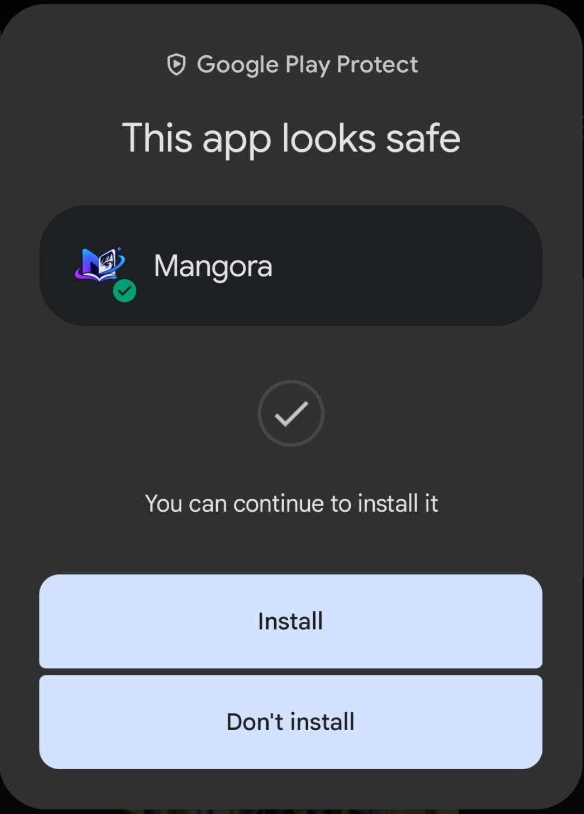

<p align="center">
  
</p>

<h3 align="center">A reader and translator for Android</h3>

<p align="center">
  
  
  
</p>

---

Mangora is an Android application for reading material obtained through extensions that the user chooses to install. It provides a shared library and reader, optional offline chapter downloads, on-device text detection and OCR, and optional text translation overlays. Mangora operates no application server or backend: the library, history, settings, OCR models, translation cache, and usage counters live on the device. Optional online features contact third-party services directly from the device.

**Mangora is not a manga publisher, content catalogue, or content-hosting service.** It does not ship a built-in list of reading providers. Users may add compatible extension repositories and install extensions; those extensions determine which catalogs and external services the app can contact. Mangora does not operate or endorse those independent repositories, extensions, websites, or services.

> Reading, downloading, OCR, and translation can involve requests to third parties. See [Privacy](https://mangora-web.web.app/privacy), [Terms](https://mangora-web.web.app/terms), and [Copyright and DMCA Policy](https://mangora-web.web.app/copyright).

## Google Play Protect scan

Google Play Protect reported that Mangora looks safe to install in this scan:

<p align="center">
  
</p>

## What the app does

### Library and history

- Stores a local library, reading history, and chapter progress.
- Supports user-created libraries, search, filtering, and sorting.
- Reopens reader positions and tracks completed and in-progress chapters.

### Reader

- Provides vertical scroll, horizontal scroll, vertical paged, and horizontal paged modes.
- Offers fit/original sizing, zoom, rotation and orientation controls, tap zones, page navigation, and auto-scroll.
- Loads pages through the installed extension that supplied the chapter, or from local downloaded files when available.
- Uses native image support for formats such as AVIF and tiled decoding for very tall pages.

### Downloads and offline reading

- Saves chapters as `.cbz` archives to a folder the user selects through Android's system file picker.
- Uses a persistent download queue with Wi-Fi-only operation, per-source and per-page concurrency settings, and pause/resume/cancel controls.
- Keeps download metadata locally and reads completed archives without requiring the extension to be available.
- Offline access applies to material already downloaded; live catalogs and searches require the relevant extension and network access.

### Text recognition and translation

1. The reader obtains a page from the installed extension or local archive.
2. The on-device Manga109 speech-bubble segmenter finds bubbles and returns
   their masks. The older YOLO text detector is used only as a fallback when a
   page has no segmentable bubbles (for example, narration-only pages).
3. The on-device OCR model for the selected language reads those regions.
4. If translation is enabled, Mangora translates recognized text and displays it as an overlay.

Translation is **off by default**. OCR runs entirely on-device with one of two downloadable models, chosen from the chapter language: **PP-OCRv6 Medium** for Japanese, Chinese and English, or **PP-OCRv5 Korean** for Korean and Latin scripts. Both packs pair a DBNet text-line detector with a CTC recognizer, so multi-line bubbles are split into lines before recognition. PP-OCRv6 is about 82 MB; the Korean pack is about 18 MB. Download either pack from **Settings > OCR models**.

Each PP-OCR pack runs one detector + recognizer engine. The OCR settings slider (1-8, default 8) is the recognizer **batch size** for both PP-OCRv6 and PP-OCRv5 Korean: it groups that many detected text lines into one forward pass, and falls back to smaller batches automatically if a device rejects a shape.

There are two translation engines:

- **Free:** sends each recognized bubble and language information to Google's public translation endpoints. It does not require an API key.
- **AI:** sends recognized text, and optionally prior-page text context, to the Gemini API using the API key saved by the user.

The reader provides three translation modes:

- **Off:** no OCR or translation pipeline is started.
- **Single page:** translates only the current page on demand.
- **Auto:** translates pages automatically as you read. Pages go into one OCR queue and the current page plus the look-ahead window are prepared in order.

OCR and translation are distinct. Text recognition never leaves the device. Free or AI translation still sends recognized text to the respective translation service.

Reader panels are split into **Advance** and **Metrics**. Advance holds the look-ahead window (1-5, default 2), the AI model picker, the auto-model-switch toggle and this manga's translation cache. Metrics holds the pipeline queue table and, in AI mode, live Gemini RPM/TPM/RPD meters. Shared limits live in **Settings > Translation**: max context pages, OCR batch size, model selection and the Gemini API key. Downloaded chapters can also be queued for background processing from **Settings > Translation queue**; pages with a cached result are skipped. Pre-translation snapshots the current settings when a job is queued. Paused jobs resume from their stored next-page index, so cached pages are not recounted or re-notified.

Speech-bubble masks drive both sides of the overlay. The mask interior is erased while the inked outline is preserved, and translated lines are laid out against the bubble's width at each line height. A page-consistent font target plus the source line count keeps the result close to a scanlation paste instead of stretching text to every bubble edge.

Translation results and OCR text used for overlays may be cached in the local SQLite database. The user can clear the translation cache from Settings.

## Extension and content model

Mangora provides an extension host, not a curated content catalog:

1. The user adds a compatible extension repository URL in Browse.
2. Mangora retrieves that repository's catalog metadata and makes available extensions visible in the app.
3. The user chooses an extension to download. Mangora checks the package name and version against the repository metadata and checks its signing certificate when a certificate fingerprint is supplied.
4. Android's package installer handles installation. Installed extension software supplies its catalog/search behavior and makes requests to its own service endpoints.
5. Mangora presents returned details and pages through shared library, reader, and download screens.

These checks are consistency checks, **not** a security audit or certification. Repository metadata and extension APKs are supplied by third parties; signing-key checking is only possible when repository metadata includes a key. Only install software and use services you trust. Review the repository, extension, service terms, and privacy notices yourself.

Mangora cannot verify that third-party material is licensed or lawful, cannot change or remove material from third-party servers, and does not guarantee third-party availability or conduct. For a complaint about material, contact the service or hosting platform that controls it. See the [Copyright and DMCA Policy](https://mangora-web.web.app/copyright).

## Data storage and network behavior

### Stored on your device

Mangora operates no user account system, application backend, or central database for app data. The library, reading history, progress, settings, extension repository settings, download records, OCR models, translation cache, and Gemini usage counters are kept on the device.

The app keeps library records, metadata, progress, history, settings, extension repository settings, download records, and translation cache data in app-private SQLite and files. Settings include the Gemini API key when one is saved. Mangora does not claim that the API key or database backup is encrypted by the app.

Downloaded `.cbz` files and backups are written to locations the user authorizes through Android's document picker. A whole-database backup may contain settings, keys, reading data, and cached OCR/translation text. Keep it in a secure location. Files saved outside app-private storage may remain after uninstalling Mangora or clearing app data.

### Requests that leave the device

Depending on the feature being used, the device may communicate with:

- The repository URL and APK/icon hosts selected through an extension repository.
- The endpoints used by the installed extension for browsing, search, metadata, images, and downloads.
- Google's public translation endpoints when free translation is selected. They receive recognized text and source/target language information.
- Google's Gemini API when AI translation or API-key validation is used. Gemini receives recognized text, optional prior-page text context, and the API key used for the request.
- GitHub's release API and asset hosting when checking for or downloading updates.
- Hugging Face model distribution hosts when downloading an on-device OCR model from Settings.

Requests originate in the app and go directly to the endpoints described above; no request passes through a Mangora server. Receiving services can ordinarily receive network metadata such as IP address, request time, URL, and client/request headers. Extension behavior can include cookies or other headers. Each service has its own policies and retention practices. The project does not operate a user account service or a central sync backend for your library, history, or settings.

The website is hosted on Firebase Hosting and fetches release information from GitHub from your browser. It may temporarily cache release responses in browser session storage. See the [Privacy Policy](https://mangora-web.web.app/privacy) for a fuller data-flow explanation and external service details.

## Privacy controls

- Leave translation off to avoid sending recognized text to a translation service.
- Do not enable online translation unless you accept sending OCR text to that service.
- Do not install repositories or extensions unless you trust their operators.
- Remove app records and clear the translation cache using available in-app controls.
- Clear Android app storage or uninstall to remove app-private data; manage files in user-selected folders separately.
- Protect the device, saved API keys, backups, and downloaded files.

Mangora's current application and website source do not include a Mangora analytics or advertising SDK. That does not make requests to extension, translation, model-download, hosting, or update services anonymous; those operators may process standard request information under their own policies.

## Installation

Android APKs target Android 7.0 (API 24) or later. The release workflow builds separate **ARM64 (`arm64-v8a`)** and **32-bit ARM (`armeabi-v7a`)** APKs. Those builds run independently, so one ABI build can still be published if the other fails. Manual workflow runs produce test artifacts without publishing a release. Test the ARMv7 APK on a 32-bit Android device before relying on it; local Android builds remain ARM64-focused.

Download the current release from the official [GitHub Releases](https://github.com/MR-LORD-REX/mangora/releases) page or an official Mangora channel. Android may ask you to allow installation from the browser or file manager that opened the APK. Only install builds from a channel you trust.

## Development

### Requirements

- Node.js 20 or newer
- JDK 17
- Android SDK and an Android ARM64 emulator or device for local development

Expo Go is not sufficient for native ONNX Runtime, Skia and image features. Use an Android development build.

### Install, run, and check

```powershell
npm install
npx expo run:android
npx expo start
npx tsc --noEmit
npx eslint .
```

### Build an Android release APK

From the `android` directory:

```powershell
.\gradlew.bat :app:assembleRelease
```

For a clean release build, run the clean task separately before assembling:

```powershell
.\gradlew.bat clean
.\gradlew.bat :app:assembleRelease
```

The project uses Expo SDK 54, React Native 0.81, React 19, Expo Router, TypeScript, Expo SQLite with Drizzle, ONNX Runtime, Skia, and native Kotlin Android modules. Android release artifacts are large because they include native OCR and image-processing code.

## Repository map

- `app/` - Expo Router screens and navigation.
- `app/reader/[id].tsx` - reader screen and translation-settings wiring.
- `app/settings/translation-queue.tsx`, `app/settings/ocr-models.tsx` - pre-translation and OCR model settings screens.
- `components/reader/ReaderTranslationPanel.tsx` - translation sheet, mode/engine controls, API usage, and pipeline metrics.
- `components/settings/`, `components/translation/` - settings sections and the downloaded-chapter pre-translation dialog.
- `utils/reader/useReaderTranslation.ts` - reader translation orchestrator, queues, workers, batching, and RAM page store.
- `services/ocr/` - on-device OCR engine pool (`localOcr.ts`), batched PP-OCR CTC recognizer (`paddleRecEngine.ts`), PP-OCR DBNet line detector (`paddleDetEngine.ts`), model catalog/downloads, ONNX Runtime setup, and crop types.
- `services/yolo/` - text-region detection.
- `services/translation/` - free and Gemini engines, page/bubble translation helpers, quota accounting, runtime lock, language mapping, pre-translation queue, and reusable work queue.
- `services/extensions/` - repository catalog parsing, extension installation, and the native bridge.
- `services/db/` - SQLite schema, migrations, backup/restore, and repositories.
- `services/downloader/` - queue, page acquisition, archive creation, and storage.
- `services/notifications/` - foreground download and pre-translation notifications.
- `plugins/android/` - native Android modules and Expo config plugins.
- `mangora-website/` - public website and its policy pages.

## Legal and licensing

The [Terms of Use](https://mangora-web.web.app/terms), [Privacy Policy](https://mangora-web.web.app/privacy), and [Copyright and DMCA Policy](https://mangora-web.web.app/copyright) describe the project's current position and data flows. They are not legal advice and do not guarantee immunity from claims. No disclaimer can remove a responsibility or right that applicable law does not allow to be waived.

Mangora's code, native dependencies, OCR models, fonts, graphics, and other bundled materials may be governed by different licenses and notices. See `LICENSE.txt` and third-party notices distributed with the project. Do not assume that a software license grants permission to use, reproduce, or distribute content returned by an extension or any third-party service. Verify all relevant licenses before redistribution or commercial use.

---

Mangora is reader and translation software. The content and services accessed through user-installed extensions are independently operated and are not provided or controlled by Mangora.
